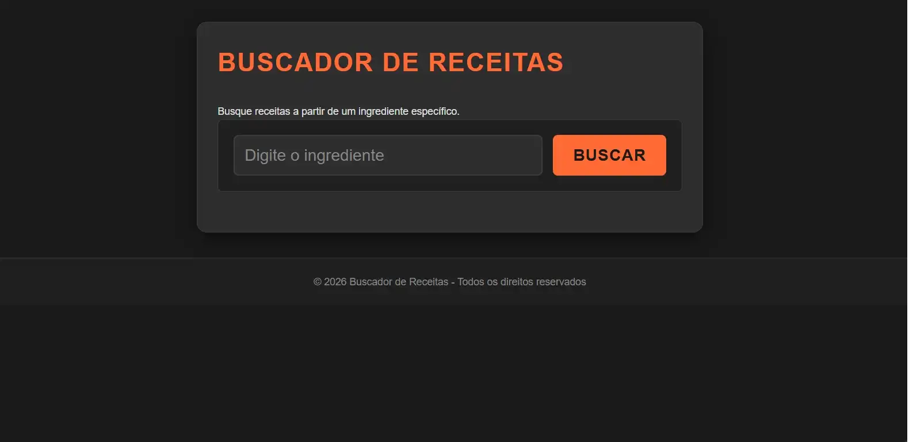

# 🍳 Buscador de Receitas

Aplicação web front-end com rotas serverless na Vercel para pesquisar receitas a partir de ingredientes digitados em português, exibindo cards de resultados e detalhes completos (tempo de preparo, rendimento, ingredientes e modo de preparo traduzidos para o português).



## ✨ Funcionalidades

- **Busca por ingrediente em português:** Normaliza acentos e letras (`limparPalavra`), consulta um dicionário local (`dicionarioIngredientes`) com mais de 70 ingredientes comuns e, caso o termo não esteja no dicionário, realiza tradução automática (`pt` → `en`).
- **Rotas Serverless na Vercel:** Encapsula a chamada à API da Spoonacular em `/api/receitas` e `/api/detalhes`, mantendo a chave da API protegida em variável de ambiente no servidor.
- **Listagem e detalhes da receita:** Exibe até 12 receitas por busca em grade responsiva e, ao clicar em um card, carrega tempo de preparo (`readyInMinutes`), porções (`servings`), lista de ingredientes e instruções traduzidas (`en` → `pt`).
- **Layout responsivo:** Adapta o grid de cards, tipografia e formulário em vários breakpoints até telas de `360px`, com tema escuro e destaques em laranja (`#FF6B35`).

## 🛠️ Tecnologias Utilizadas

- **HTML5** (`index.html` com meta tags de SEO, Open Graph e Twitter Cards)
- **CSS3** (`css/geral.css`, `css/hero.css`, `css/sections.css`, `css/footer.css`, `css/responsivo.css` com variáveis CSS e media queries)
- **JavaScript (Vanilla JS)** (`js/script.js` com `fetch`, `async/await`, manipulação de DOM e tradução via endpoint público do Google Translate)
- **Vercel Serverless Functions** (`api/receitas.js` e `api/detalhes.js` em Node.js)
- **Spoonacular API** (endpoints `complexSearch` e `/{id}/information`)

## 📁 Estrutura do Projeto

```text
├── api/
│   ├── detalhes.js       # Rota serverless para buscar detalhes de uma receita por ID
│   └── receitas.js       # Rota serverless para buscar receitas por termo/ingrediente
├── assets/
│   └── favicon.png       # Ícone da aba do navegador
├── css/
│   ├── footer.css        # Estilos do rodapé
│   ├── geral.css         # Variáveis base, reset e estilos do body
│   ├── hero.css          # Estilos do container principal e título
│   ├── responsivo.css    # Breakpoints de responsividade (até 360px)
│   └── sections.css      # Estilos do formulário, grade de cards e modal/painel de detalhes
├── js/
│   └── script.js         # Dicionário de ingredientes, tradução, requisições e renderização
└── index.html            # Página principal da aplicação